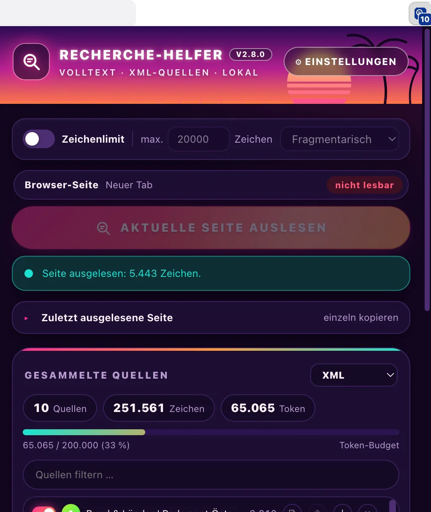

<div align="center">

# Recherche-Helfer → XML-Quellen

**Assisted-manuelle Recherche für LLM-Prompts: die offene Seite (Web oder PDF) als saubere XML-Quelle.**
Kein Backend · kein Serverkontakt · keine Automatisierung · alles lokal

[](#installation)
[](#technik)
[](#datennutzung--privatsphäre)
[](#warum)
[](#lizenz)

**[➜ XML-Editor: xml-prompt-baukasten](https://juristikde.github.io/xml-prompt-baukasten/)** · **[➜ Prompt-Bibliothek](https://juristikde.github.io/xml-prompt-bibliothek/)**



</div>

---

## Inhaltsverzeichnis

- [Warum?](#warum)
- [Features](#features)
- [Installation (Zip → Browser)](#installation-zip--browser)
  - [Schritt 1: Zip herunterladen](#schritt-1-zip-herunterladen)
  - [Schritt 2: Entpacken](#schritt-2-entpacken)
  - [Schritt 3: Im Browser hinzufügen](#schritt-3-im-browser-hinzufügen)
  - [Schritt 4 (optional): Lokale Dateien auslesen](#schritt-4-optional-lokale-dateien-auslesen)
- [Bedienung](#bedienung)
- [Workflow: Recherche → XML → Prompt](#workflow-recherche--xml--prompt)
- [Zusammenspiel mit dem XML-Prompt-Baukasten](#zusammenspiel-mit-dem-xml-prompt-baukasten)
- [Auslesen im Detail](#auslesen-im-detail)
- [PDF](#pdf)
- [Export-Formate](#export-formate)
- [Einstellungen](#einstellungen)
- [Tastenkürzel](#tastenkürzel)
- [Datennutzung & Privatsphäre](#datennutzung--privatsphäre)
- [Technik](#technik)
- [Projektstruktur](#projektstruktur)
- [Mitwirken](#mitwirken)
- [Lizenz](#lizenz)

---

## Warum?

> Gute Prompts mit Quellen brauchen keine fleißige Maus, sondern eine saubere Quelle – als XML.

LLMs arbeiten mit strukturierten Quellen deutlich verlässlicher als mit复制-paste-Fließtext aus dem Browser: Navigation, Cookie-Banner und Werbeblöcke verrutschen ins Prompt, Metadaten fehlen, Markdown-Kopfzeilen werden zerstört.

**Recherche-Helfer** liefert stattdessen: Sprache, Titel, Autor, URL und bereinigten Volltext als `<quelle>`-Block – bereit zum Einfügen.

**Assisted-manuell heißt:** Das Tool öffnet **niemals selbst** Links, klickt **niemals selbst** durch Suchergebnisse und läuft nie im Hintergrund. Jede Quelle entsteht nur durch deine explizite Aktion – Buttons oder `Alt+Shift+R`. Du entscheidest, was das Modell zu sehen bekommt.

**Typische Einsatzfelder:** Recherche-Prompts mit belegbaren Quellen, Faktenchecks, Quellenvergleiche, Datenextraktion aus Webseiten und PDFs.

---

## Features

| Bereich | Was du bekommst |
| --- | --- |
| **Auslesen** | Gesamter sichtbarer Seitentext; optional nur Hauptinhalt oder nur die Textmarkierung; zugeklappte `<details>` werden geöffnet (max. 12 Klicks, Links/Formulare werden nie angeklickt) |
| **PDF** | Automatisch erkannt und lokal per pdf.js entziffert (bis 150 MB); Seitenmarker `[Seite 3]` optional |
| **Struktur** | Überschriften als `#`/`##`-Marker, Listenpunkte, Tabellen mit `\|`; Same-Origin-Iframes und offene Shadow DOMs inklusive |
| **Lazy Load** | Bis zu 4 Scroll-Durchgänge für nachladende Inhalte; wartet auf stabilen Seitentext |
| **Metadaten** | Autor, Datum, Seitenname, Sprache, Beschreibung aus Meta-Tags und JSON-LD – ideal zum Zitieren |
| **Export** | **XML** (`<quelle>`-Blöcke) oder **Markdown** (nummerierte Abschnitte); Kopieren oder Download |
| **Prompt-Rahmen** | Eigener Text vor/nach den Quellen; Vorlagen (Zusammenfassung, Faktencheck, Quellen vergleichen, Daten extrahieren); Platzhalter `{datum}`, `{uhrzeit}`, `{anzahl}`, `{zeichen}`, `{token}`, `{quellenliste}` |
| **Token-Budget** | Balken zeigt den Verbrauch (Standard 200.000); „Auf Budget kürzen“ nach Wasserstandsverfahren – keine Quelle geht verloren |
| **Sammlung** | Quellenliste mit Domain-Avataren, Ein-/Ausschalten pro Quelle, ↑/↓-Reihenfolge, Dupletten-Cleanup (Shingle/Jaccard), Undo, Wiederherstellen (↺) |
| **Privatsphäre** | Maskieren sensibler Daten (IBAN, Karten, API-Keys, E-Mails), Domain-Sperrliste, Tracking-Parameter und Google-Redirect-URLs werden entfernt |

Kein Account, kein Server, keine Telemetrie.

---

## Installation (Zip → Browser)

Die Erweiterung liegt in diesem Repo als **Ordner und als Zip**. Du brauchst keine Zip-Variante aus dem Chrome Web Store – sie ist nicht drin und muss das auch nicht sein.

### Schritt 1: Zip herunterladen

**Variante A – das fertiges Zip aus diesem Repo**
Lade die Zip-Datei aus dem Repo ( Repositorie-Ansicht → Klick auf die Datei → **Download**-Button ) herunter.

**Variante B – Code → Download ZIP**
Grüner **`<> Code`**-Button → **Download ZIP** – das ist das Gleiche, nur frisch aus dem aktuellen Stand.

### Schritt 2: Entpacken

Entpacke die Zip an einen **dauerhaften** Ort (nicht in den Papierkorb-Downloads-Ordner, den du einmal leerst – Chrome lädt die Erweiterung** von dort**):

```text
windows: Rechtsklick → „Alle extrahieren…"
macOS:   Doppelklick auf die .zip
Linux:   unzip <datei>.zip
```

Danach liegt ein Ordner bereit, etwa `research-tool/` (oder der Name aus dem Zip) mit `manifest.json`, `background.js`, `popup.html`, `popup.js` usw.

> **Der Ort bleibt der Programmspeicher der Erweiterung.** Nicht löschen, nicht umbenennen, solange du sie nutzt.

### Schritt 3: Im Browser hinzufügen

Getestet in **Chrome** (ab Version 116); funktioniert genauso in **Edge**, **Brave**, **Opera** und anderen Chromium-Browsern:

1. Adresse `chrome://extensions` aufrufen
2. Schalter **Entwicklermodus** (rechts oben) aktivieren
3. **„Entpackte Erweiterung laden“** klicken
4. Den **entpackten Ordner** auswählen (der mit der `manifest.json` – nicht die Zip selbst)
5. Das Erweiterungssymbol erscheint in der Toolbar – optional anpinnen 📌, damit es immer sichtbar ist

Nach einem Browser-Neustart bleibt die Erweiterung geladen. Ein „Fehler laden“-Banner bedeutet fast immer: du hast die Zip statt des Ordners ausgewählt.

### Schritt 4 (optional): Lokale Dateien auslesen

Um HTML/PDF von der eigenen Festplatte (`file://`) zu sammeln: auf `chrome://extensions` → Karte der Erweiterung → **Details** → **„Zugriff auf Datei-URLs zulassen“** aktivieren.

---

## Bedienung

1. Seite öffnen (Webseite oder PDF). Optional: Text markieren, um **nur die Markierung** zu übernehmen – oder nichts markieren für den Volltext
2. **`Alt+Shift+R`** oder das Erweiterungssymbol → **„Aktuelle Seite auslesen“** (auch ohne offenes Popup)
3. Auf jeder weiteren interessanten Seite: Schritt 2 wiederholen – gleiche URLs werden **ersetzt statt doppelt**, Rechtsklick auf eine Markierung fügt **mehrere Ausschnitte** derselben Seite hinzu
4. Im Popup: Quellen prüfen (ein-/ausschalten, Vorschau, Reihenfolge), Format **XML** oder Markdown wählen
5. **Kopieren** (oder Download) → XML-Sammlung liegt in der Zwischenablage → in den Prompt einfügen

Die Bestätigung erscheint direkt auf der Seite („✓ Gelesen · 3 Quellen · ≈ 12.687 Token“), auch ohne offenes Popup. Die Quellenzahl steht am Erweiterungssymbol als Badge.

---

## Workflow: Recherche → XML → Prompt

```text
Google-Suche             Website/PDF             Popup              Prompt
┌────────────┐          ┌─────────────┐        ┌──────────┐        ┌──────────┐
│ Du klickst │  ──────► │ Alt+Shift+R │ ─────► │ Sammlung │ ─────► │  Kopieren │
│ Treffer an │          │  auslesen   │        │  prüfen  │        │  in Chat  │
└────────────┘          └─────────────┘        └──────────┘        └──────────┘
```

Das Tool geht **nie selbst** durch die Trefferliste – assisted-manuell heißt: Du entscheidest jede Quelle einzeln.

Am Ende steht eine fertige XML-Sammlung mit Kopfzeile:

```xml
<!-- 3 Quellen, 41.302 Zeichen Inhalt ≈ 10.401 Token -->
<quellen>
  <quelle id="1">
    <url><![CDATA[https://example.com/artikel]]></url>
    <titel><![CDATA[Titel der Seite]]></titel>
    <autor><![CDATA[Max Mustermann]]></autor>
    <datum><![CDATA[2026-11-23]]></datum>
    <inhalt><![CDATA[# Überschrift
… bereinigter Volltext mit #结构-Markern …]]></inhalt>
  </quelle>
  <!-- … weitere Quellen … -->
</quellen>
```

---

## Zusammenspiel mit dem XML-Prompt-Baukasten

Der Export ist bewusst **XML** – das passt direkt in den [**XML-Prompt-Baukasten**](https://juristikde.github.io/xml-prompt-baukasten/), den visuellen Editor für strukturierte LLM-Prompts:

1. Sammlung im Recherche-Helfer kopieren (`Alt+Shift+C`)
2. Im Prompt-Baukasten: **XML anzeigen** → Sammlung einfügen → **Übernehmen** – die `<quelle>`-Blöcke werden als Baumstruktur übernommen
3. Drumherum den Prompt bauen: `<rolle>`, `<aufgabe>`, `<regeln>` – die Quellen als `<quellen>`-Ast einbetten
4. Das fertige Prompt-XML kopieren und an das Modell übergeben

```xml
<prompt>
  <rolle>Du bist ein Recherche-Assistent …</rolle>
  <aufgabe>Fasse die folgenden Quellen zusammen und belege jede Aussage mit der Quellen-ID.</aufgabe>
  <regeln>
    <regel>Nenne nur Fakten, die in den Quellen stehen.</regel>
  </regeln>
  <quellen>
    <!-- ── hier die <quelle>-Blöcke aus dem Recherche-Helfer einfügen ── -->
  </quellen>
</prompt>
```

Vorlagen wie „Zusammenfassung“ oder „Quellen vergleichen“ (im Recherche-Helfer, Einstellungen → Profile & Prompt-Vorlagen) liefern den Rahmen dafür fertig mit Platzhaltern wie `{quellenliste}` und `{datum}`.

Eine kuratierte Sammlung fertiger Prompt-Vorlagen: [xml-prompt-bibliothek](https://juristikde.github.io/xml-prompt-bibliothek/).

---

## Auslesen im Detail

- **Standard:** gesamter sichtbarer Seitentext (Body, nicht nur `<article>`), optional nur Hauptinhalt (`article`/`main`/Absatz-Cluster) oder nur die Markierung
- Zugeklappte `<details>` und „Mehr anzeigen“ werden geöffnet (max. 12 Klicks – **nur echte Buttons/Toggles**, nie Links, Downloads oder Formulare; Seitenwechsel während dessen blockiert)
- Same-Origin-Iframes werden mitgelesen; Text aus offenen Shadow DOMs ergänzt
- Cookie-Banner/Werbung optional ausblendbar, Navigation/Footer/Seitenleisten optional weglierbar (spart Token)
- Bis zu 4 Scroll-Durchgänge für Lazy Load / Infinite Scroll (einstellbar); das Tool wartet auf stabilen Seitentext
- Textbereinigung: Leerzeichen, Zero-Width- und Bidi-Steuerzeichen, Skip-Links; wiederholte Zeilen (Menüs) optional zusammenfassen

## PDF

PDFs werden automatisch erkannt – über URL, Content-Type oder `%PDF-`-Magic-Bytes per Range-Request – und **lokal** mit [pdf.js](lib/pdfjs-LICENSE.txt) im Offscreen-Dokument ausgelesen. Der komplette Text aller Seiten wird extrahiert (bis 150 MB); Titel/Autor/Datum kommen aus den PDF-Metadaten, optionale Seitenmarker (`[Seite 3]`) halten den Bezug beim Zitieren. Wird eine PDF angefragt, wird sie auch gelesen.

## Export-Formate

| Format | Aussehen | Gut für |
| --- | --- | --- |
| **XML** (Standard) | `<quelle>`-Blöcke mit `<url>`, `<titel>`, optionalen Metadaten; CDATA-sicher; optionales `<quellen>`-Wurzelelement und `id`-Nummerierung | [XML-Prompt-Baukasten](https://juristikde.github.io/xml-prompt-baukasten/), strukturierte Prompts |
| **Markdown** | nummerierte Quellenabschnitte | Chats ohne XML-Struktur |

Beides mit kurzer Kopfzeile (Anzahl Quellen / Zeichen / Token-Schätzung), als Kopierbefehl oder Datei-Download. Überschreitet die Sammlung das Token-Budget, kürzt „Auf Budget kürzen“ nach Wasserstandsverfahren: kurze Quellen bleiben komplett, die längsten teilen sich den Rest – „↺“ stellt die Originale wieder her.

## Einstellungen

| Einstellung | Bedeutung |
| --- | --- |
| **Profile** | „Ausgewogen“, „Token sparen“, „Maximal vollständig“ – mehrere Werte mit einem Klick |
| **Prompt-Vorlagen** | Zusammenfassung, Faktencheck, Quellen vergleichen, Daten extrahieren; danach frei editierbar |
| **Token-Budget** | Standard 200.000; Balken zeigt Verbrauch, Kürzen nach Wasserstandsverfahren |
| **Textbegrenzung** | Fragmentarisch wortweise oder Hard Cut, für einzelne sehr große Quellen |
| **Struktur** | Überschriften-/Listen-Marker, Tabellen als `\|`-Trenner, Linkliste je Quelle |
| **Auslesen** | Hauptinhalt-only, Cookie-Banner ausblenden, Scroll-Durchgänge (Lazy Load) |
| **Datenschutz** | Sensible Angaben maskieren (IBAN, Karten, API-Keys, E-Mails), Domain-Sperrliste |
| **Export** | XML/Markdown, Wurzelelement, Nummerierung, Prompt-Rahmen, Platzhalter |
| **Darstellung** | Design „Sunset“, „Day“, „Automatisch“; Animationen abschaltbar (respektiert „Bewegung reduzieren“) |
| **Sichern** | Einstellungen als JSON exportieren/importieren |

## Tastenkürzel

| Kürzel | Aktion |
| --- | --- |
| `Alt+Shift+R` | Aktuelle Seite auslesen (auch ohne offenes Popup) |
| `Alt+Shift+C` | Gesamte Sammlung in die Zwischenablage kopieren |
| `Alt+Shift+Z` | Letzte Quelle entfernen |
| Rechtsklick auf Markierung | Markierung als Quelle hinzufügen |
| `Enter` im Popup | Aktuelle Seite auslesen |

Komplett per Tastatur recherchieren: Seiten nacheinander mit `Alt+Shift+R` einsammeln, am Ende `Alt+Shift+C` – fertig.

## Datennutzung & Privatsphäre

- **Kein Serverkontakt des Tools**; Seiten werden nur über den normalen Browser-Traffic geladen
- Google-Weiterleitungs-URLs (`/url?q=…`) und Tracking-Parameter (`utm_*`, `gclid`, `fbclid`, …) werden beim Speichern entfernt
- Sensible Angaben können vor dem Speichern maskiert werden (IBANs, Kartennummern, API-Keys/Tokens, E-Mails) – kein Maskieren ist eine Garantie, prüfe den Inhalt trotzdem kurz vor dem Einfügen
- Domain-Sperrliste für Seiten, die nie ausgelesen werden sollen (gilt auch für den Rechtsklick)
- Alles liegt ausschließlich lokal in `chrome.storage.local` (unbegrenzt); Statusmeldungen auf der Seite sitzen in geschlossenen Shadow DOMs und werden nie mit ausgelesen
- Nicht lesbar: Browser-interne Seiten (`chrome://…`) – der Auslesen-Button zeigt das vorher an

## Technik

| Aspekt | Umsetzung |
| --- | --- |
| Architektur | Chrome Extension Manifest V3; Service Worker + Popup + Offscreen-Dokument |
| Injektion | `chrome.scripting.executeScript` (func-Serialisierung); kurze Polling-Ticks, keine Dauerinjektion |
| PDF | [pdf.js](lib/pdfjs-LICENSE.txt) im Offscreen-Dokument, Magic-Byte-Erkennung per Range-Request |
| Speicher | `chrome.storage.local` mit `unlimitedStorage` |
| CSP | `script-src 'self' 'wasm-unsafe-eval'; object-src 'self'` (nur für den pdf.js-WASM-Worker) |
| Rechte | `tabs`, `scripting`, `storage`, `unlimitedStorage`, `clipboardWrite`, `offscreen`, `contextMenus` – bewusst schmal |

Getestet in Chrome ab Version 116 (Desktop); läuft auch in Edge/Brave/Opera.

## Projektstruktur

```text
research-tool/
├── manifest.json        # MV3-Manifest (Name, Rechte, Kürzel)
├── background.js        # Service Worker (Auslesen, PDF, Export)
├── popup.html/.js       # Sammlung, Einstellungen, Status
├── common.js            # gemeinsame Hilfsfunktionen
├── offscreen.html/.js   # Offscreen-Dokument für pdf.js
├── pdf.mjs / pdf.min.mjs / pdf.worker.min.mjs   # pdf.js-Stack
├── pdf-extract.js       # PDF-Textextraktion
├── icons/               # Erweiterungssymbol
└── test/                # Unit-, PDF- und End-to-End-Tests
```

## Mitwirken

Issues und Pull Requests sind willkommen.

1. Forken oder Zip entpacken
2. Änderungen vornehmen
3. `node test/…` laufen lassen (sofern Tests mit ausgeliefert)
4. PR mit kurzer Beschreibung und idealerweise Screenshot

Bitte keine Tracking-Skripte, keine „bequeme“ Automatisierung – der assisted-manuelle Charakter ist das Konzept.

## Lizenz

MIT – freie Nutzung privat und kommerziell. Details in [`LICENSE`](LICENSE).
```

Drei Hinzeise:

1. **Screenshot:** Die Zeile `` erwartet eine Datei `screenshots/screenshot_1.webp` im Repo (gleicher Pfadaufbau wie bei deinem Prompt-Baukasten). Einfach einen Screenshot vom Popup (z. B. mit einigen gesammelten Quellen) als `screenshot_1.webp` in den Ordner `screenshots/` legen.
2. **Ordnername:** Ich habe `research-tool/` geschrieben (aus deiner alten README). Falls der Ordner im Repo anders heißt,suche und ersetze.
3. **Lizenz:** Ich habe MIT angenommen (wie beim Prompt-Baukasten). Falls das Repo keine `LICENSE` hat, entweder eine hinzufügen oder den Abschnitt und den Badge anpassen.

Außerdem enthält der neue Ordner (der aus den Dateien im Zip) vermutlich Dateinamen wie im `manifest.json` referenziert (`manifest.json`, `background.js`, `popup.html`, `popup.js`, `common.js`, `icons/…`). Falls deine Zip intern abweicht, sag mir kurz den Aufbau, dann passe ich die Projektstruktur an.
